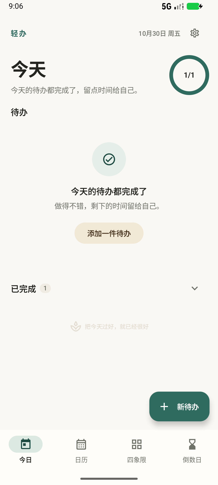
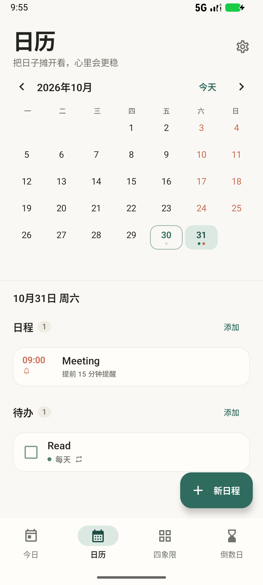
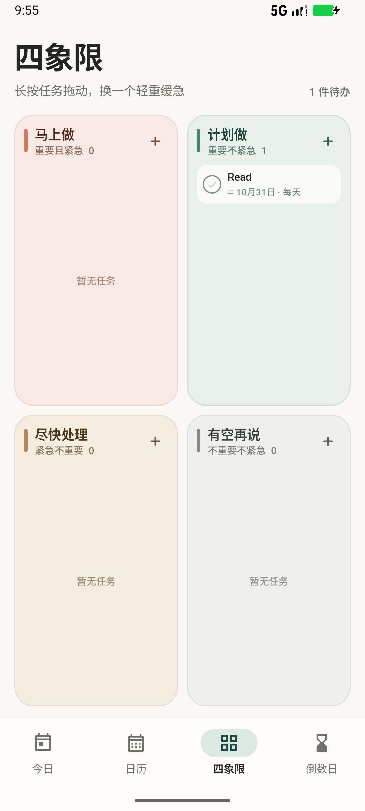
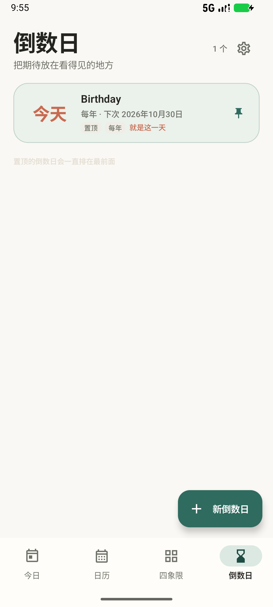
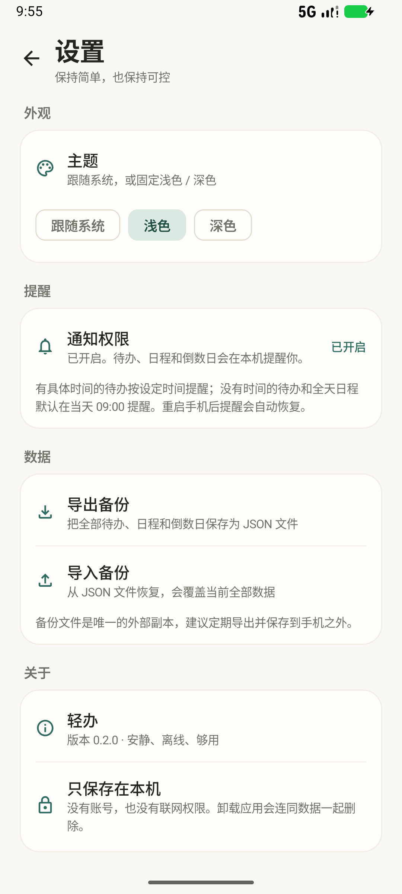

# 轻办

一个安静、离线的安卓待办应用。把每天的事情收进四个象限，把重要的日子做成倒数日；数据只保存在这台手机上。

当前版本：**0.2.0**（versionCode 2）。首版计划中的今日待办、重复待办、日历日程、四象限、倒数日、本地提醒、深色模式和 JSON 备份都已接入。

详细设计、数据结构、通知机制和完整变更记录见 [项目文档](docs/项目文档.md)。

## 界面

| 今日 | 日历 |
| --- | --- |
|  |  |

| 四象限 | 倒数日 |
| --- | --- |
|  |  |



## 安装

可安装包：

```text
dist/qingban-0.2.0-debug.apk
```

把 APK 传到安卓手机，允许“安装未知来源应用”后安装即可。最低支持 **Android 8.0**（minSdk 26），targetSdk 35。

> 这是使用 Android Debug 证书签名的测试版本，适合先装到手机上体验。后续如需上架应用商店，再生成正式签名的 release 包。

## 已经能用

### 今日待办

- 新增、编辑、完成、撤销
- 逾期任务单独收纳，可一键「移到今天」
- 当天完成进度环，已完成列表可展开查看
- 昨日未完成的任务只保留一条，不会反复堆积

### 重复待办

支持五种规则：

| 类型 | 行为 |
| --- | --- |
| 每天 | 完成后排到下一天 |
| 工作日 | 周一至周五 |
| 每周 | 可选择多个星期几 |
| 每月 | 保持最初设定的日期；短月自动落到月末 |
| 每年 | 保持最初设定的月日；2 月 29 日在平年按 2 月 28 日处理 |

- 漏做的重复任务只保留一条逾期实例，不会堆满列表
- 完成或跳过本次后，自动生成下一次
- 修改会应用到当前这一次及以后
- 支持「跳过本次」「结束重复」「删除整个重复任务」

### 四象限

- 2×2 视图，每个象限内可直接新增
- 长按任务拖动到另一个象限
- 象限内最多显示三件，可展开查看全部

### 日历与日程

- 月视图左右切换，支持快速回到今天
- 日期下方用小圆点标记待办、已完成和日程
- 选中日期后显示当天日程与待办，可直接新增或完成
- 日程支持全天 / 具体时间、备注和提醒（准时、提前 5 / 15 / 30 分钟、提前 1 小时）

### 倒数日

- 支持目标日期、备注、置顶和每年重复
- 置顶的倒数日排在最前面
- 每年重复会保持原月日，2 月 29 日按 2 月 28 日处理
- 自动显示「还有 N 天 / 就是今天 / 已过去 N 天」

### 本地提醒

- 有待办时间：按设定时间提醒
- 无具体时间的待办：当天 09:00 提醒
- 日程：按所选提前量提醒；全天日程默认当天 09:00
- 倒数日：目标日当天 09:00 提醒
- 完成重复任务后，会为下一次自动安排提醒
- 手机重启、系统时间或时区变化后，自动重建提醒
- Android 13 及以上需要通知权限，可在「设置 → 提醒」中开启
- Android 12 及以上如果没有精确闹钟权限，会自动退回非精确提醒

### 设置与备份

- 主题：跟随系统 / 浅色 / 深色
- 通知权限状态与快捷开启
- 导出 JSON 备份（待办系列、每次实例、日程、倒数日）
- 导入 JSON 备份；导入会覆盖当前全部数据，并带二次确认
- 没有账号，也没有联网权限

### 数据与升级

- Room 数据库 `qingban.db`，版本 2
- 已包含 1 → 2 迁移，可直接覆盖安装旧版本，原有待办数据会保留
- 备份格式：`app = "qingban"`、`schemaVersion = 1`

## 本地构建

环境要求：

- JDK 17 或以上
- Android SDK Platform 35
- 项目路径含中文时，`gradle.properties` 已开启 `android.overridePathCheck=true`

用 Android Studio 打开项目并等待 Gradle 同步，或使用命令行：

```powershell
.\gradlew.bat :app:assembleDebug
```

产物位于 `app/build/outputs/apk/debug/app-debug.apk`。

运行测试和静态检查：

```powershell
.\gradlew.bat :app:testDebugUnitTest
.\gradlew.bat :app:lintDebug
```

## 重复规则细节

- **每天**：完成后排到下一天
- **工作日**：周一到周五，不含法定节假日调休
- **每周**：至少选择一天；完成后找下一个选中的星期几
- **每月**：以首次设定日期为锚点；31 日遇到短月落在月末
- **每年**：以首次设定的月日为锚点；2 月 29 日在平年落在 2 月 28 日
- 错过的重复任务只保留一条逾期待办，不产生多条
- 重复任务的「结束重复」会保留当前这一次，之后不再生成

## 项目结构

```text
app/src/main/java/com/qingban/app/
├── data/          Room 实体、DAO、仓库、备份、设置
├── domain/        任务 / 日程 / 倒数日模型，重复与倒数日计算
├── notifications/ 通知渠道、AlarmManager 调度、开机恢复
├── ui/
│   ├── screens/   今日、日历、四象限、倒数日、设置
│   ├── sheets/    待办、日程、倒数日编辑器
│   ├── components/
│   └── theme/
└── MainActivity.kt
```

## 本轮验证

- `assembleDebug` 构建成功，APK 版本 0.2.0
- `lintDebug`：**No issues found**
- 11 个 JVM 单元测试通过（6 个重复日期 + 5 个倒数日日期）
- 在 API 37 模拟器上完成：旧版 0.1.0 → 新版 0.2.0 覆盖安装，Room 迁移正常
- 模拟器点击验收：新建每日待办 → 完成后次日自动出现；新建日程 → 提醒闹钟生效；通知可正常发出；JSON 导出 / 导入成功；深色模式切换正常
- 模拟器重启后，提醒闹钟由开机广播自动恢复
- 当前环境没有连接安卓真机，尚未做真机点击验收；安装后如遇到具体页面或操作问题，可直接反馈

## 后续计划

- 桌面小组件
- 农历、搜索、统计
- 更细的重复规则（每 N 天、每月第几个周几）
- 通知点击后直接定位到对应页面

## 仓库

<https://github.com/yingzi2345/QingBan>
