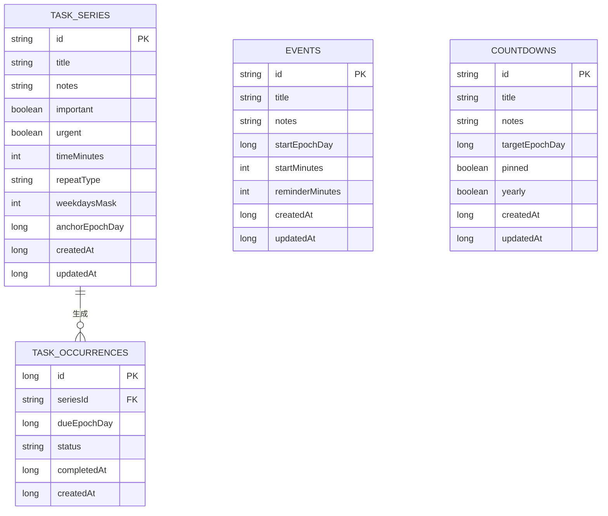
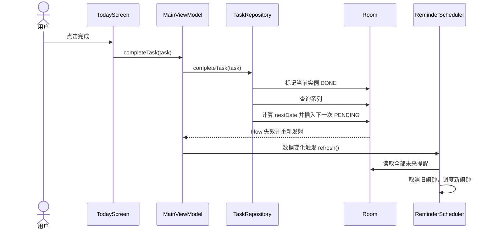
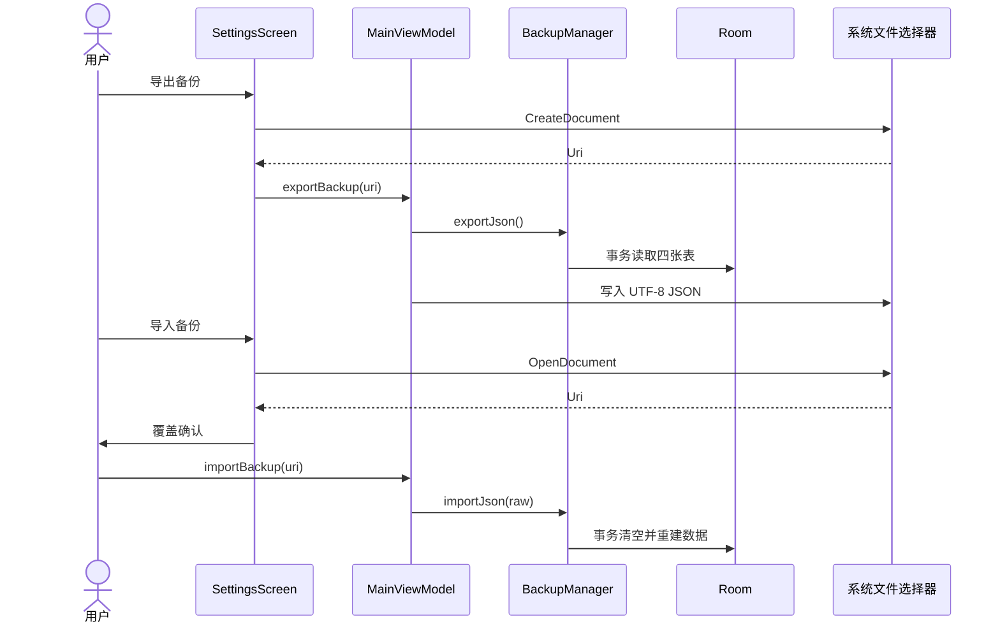

# 轻办 · 项目文档

| 项目 | 内容 |
| --- | --- |
| 应用名称 | 轻办 |
| 包名 | `com.qingban.app` |
| 当前版本 | 0.2.0（versionCode 2） |
| 最低系统 | Android 8.0（API 26） |
| 目标系统 | Android 15（targetSdk 35） |
| 技术栈 | Kotlin 2.0、Jetpack Compose、Material 3、Room、AlarmManager |
| 数据策略 | 纯本地、无账号、无联网权限 |
| 仓库 | <https://github.com/yingzi2345/QingBan> |
| 文档更新时间 | 2026-10-30 |

---

## 1. 项目概览

### 1.1 定位

「轻办」是一个安静、离线的个人待办应用。它不追求功能大而全，而是把日常最常处理的四类信息放在同一套轻量界面里：

1. 今天要做的待办；
2. 已经排好时间的日程；
3. 需要区分轻重缓急的四象限；
4. 值得等待的倒数日。

重复待办是首版的重要能力：既不能漏事，也不能让漏做的任务在列表里越堆越多。

### 1.2 设计原则

- **本地优先**：所有数据写入本机 Room 数据库，没有账号体系，也没有网络请求。
- **低压**：文案、配色和空状态避免制造焦虑，强调「一件件来」。
- **复用视图**：重复待办与普通待办共用今日、日历、四象限，不额外造页面。
- **默认克制**：首版只做每天、工作日、每周、每月、每年五种重复规则，不做复杂组合。
- **可恢复**：数据可导出为 JSON，换机或重装前能留一份外部副本。

### 1.3 视觉基调

| 角色 | 色值 | 用途 |
| --- | --- | --- |
| 墨绿 | `#2F6B5F` | 主色、按钮、选中态、进度 |
| 米白 | `#FAF8F4` | 浅色背景 |
| 珊瑚红 | `#E07A5F` / `#C96A50` | 紧急、逾期、日程时间、提醒 |
| 深夜色 | `#121512` | 深色背景 |

四象限另有低饱和的珊瑚、青绿、赭金、灰绿四组强调色，浅色/深色各有一套容器色。

---

## 2. 版本与交付

### 2.1 构建信息

| 项 | 值 |
| --- | --- |
| versionName | `0.2.0` |
| versionCode | `2` |
| minSdk | 26 |
| targetSdk / compileSdk | 35 |
| JDK | 17+（当前构建环境为 JDK 21） |
| Gradle | 8.9 |
| AGP | 8.7.3 |
| Room | 2.6.1 |
| Compose BOM | 2024.12.01 |

### 2.2 安装包

```text
dist/qingban-0.2.0-debug.apk
```

- 大小：约 20.5 MB
- 签名：Android Debug 证书
- SHA-256：`1C2DC2E5984ECF327DD897CBC3AEEF97ED49ADBE863607B477536EBDE2B63331`
- Android 8.0 及以上可安装

> Debug 签名只适合真机体验与内部测试。若未来上架应用商店，需要创建正式 keystore 并生成 release 包。

---

## 3. 功能范围

### 3.1 首版已实现

| 模块 | 能力 |
| --- | --- |
| 今日待办 | 新增、编辑、完成、撤销、逾期收纳、移到今天、完成进度 |
| 重复待办 | 每天 / 工作日 / 每周 / 每月 / 每年；不堆积；跳过、结束、删除 |
| 四象限 | 2×2 展示、象限内新增、长按拖拽换象限、查看全部 |
| 日历 | 月视图、月份切换、回到今天、日期圆点、当天议程 |
| 日程 | 全天 / 具体时间、备注、提醒偏移、编辑、删除 |
| 倒数日 | 目标日期、备注、置顶、每年重复、剩余天数 |
| 提醒 | 待办、日程、倒数日三类本地通知；重启恢复 |
| 主题 | 跟随系统 / 浅色 / 深色 |
| 设置 | 通知权限、主题、备份入口、版本信息 |
| 备份 | JSON 导出、JSON 导入、导入二次确认 |
| 数据 | Room v2，含 1 → 2 迁移 |

### 3.2 不在首版范围

- 云同步、账号、协作
- 桌面小组件
- 农历、搜索、统计
- 重复日程（重复规则只作用于待办）
- 「仅修改本次」的重复实例编辑
- 每 N 天、每月第几个周几等复杂重复规则
- 通知点击后深链到具体页面（目前打开应用首页）

---

## 4. 功能规格

### 4.1 今日待办

- 今日列表按时间升序，无时间的任务排在后面。
- 逾期任务单独放在「逾期」分组，并显示原定日期。
- 逾期任务提供「移到今天」，只改当前实例的日期，不改重复系列锚点。
- 完成任务的同一事务内：
  1. 将当前实例标记为 `DONE` 并记录 `completedAt`；
  2. 若系列为重复任务，生成下一次 `PENDING` 实例。
- 撤销完成时：
  1. 若本次生成的下一次实例仍为 `PENDING`，删除它；
  2. 将原实例恢复为 `PENDING`。
- 已完成列表默认折叠，展开后展示完成状态与时间。

### 4.2 重复待办

#### 支持类型

| 类型 | 计算方式 | 示例标签 |
| --- | --- | --- |
| 每天 `DAILY` | 完成后排到次日 | 每天 |
| 工作日 `WEEKDAYS` | 周一到周五 | 工作日 |
| 每周 `WEEKLY` | 按一周位掩码选中的星期几 | 每周一、三、五 |
| 每月 `MONTHLY` | 以锚点日为准，短月落到月末 | 每月 15 日 |
| 每年 `YEARLY` | 以锚点月日为准，2 月 29 日平年落到 2 月 28 日 | 每年 10 月 29 日 |

#### 核心规则：漏做不堆积

每个重复系列在任意时刻最多只有一个待完成实例。打开应用时，如果上一次没做，只看到一条逾期实例，不会出现多条。

示例：每天的任务，周一、周二都没完成。

```text
周一实例（PENDING，due=周一）
  ↓ 周二、周三打开应用，仍只有这一条
周三完成
  ↓ max(今天=周三, due=周一) + 1 天
下一次 = 周四
```

如果点「跳过本次」：

```text
当前实例 → SKIPPED
下一次 = max(今天, 当前 due) + 规则步长
```

跳过不算完成，也不写入完成历史。

#### 操作语义

| 操作 | 行为 |
| --- | --- |
| 修改 | 修改系列标题、备注、时间、象限、重复规则；日期变更时更新锚点；应用到当前及以后 |
| 跳过本次 | 当前实例标记 `SKIPPED`，生成下一次 |
| 结束重复 | 系列 `repeatType` 改为 `NONE`，保留当前实例，之后不再生成 |
| 删除整个重复任务 | 删除系列，外键级联删除全部历史实例 |
| 完成 | 当前实例 `DONE`，生成下一次 |

#### 边界处理

- **每月 31 日**：目标月份没有 31 日时，使用该月最后一天。锚点仍保留原始「31 日」，下个月恢复。
- **每年 2 月 29 日**：平年使用 2 月 28 日，闰年恢复 2 月 29 日。
- **工作日**：只排除周六、周日，不含中国法定节假日与调休。
- **重复任务提醒**：完成当前实例并生成下一次后，由数据变化监听自动重排下一次提醒。

### 4.3 四象限

- 依据 `important`（重要）和 `urgent`（紧急）两个布尔值映射四个象限：
  - 重要且紧急 → 马上做
  - 重要不紧急 → 计划做
  - 紧急不重要 → 尽快处理
  - 不重要不紧急 → 有空再说
- 每个象限内最多显示 3 件，超出时显示「查看全部 N 件」。
- 长按任务进入拖动，拖动到另一个象限后写入系列级标记，所有实例共享。
- 象限内「+」新建任务时会预填对应象限。

### 4.4 日历与日程

- 月视图使用周一为每周第一天，固定 6 行网格。
- 日期圆点：
  - 墨绿：当天存在未完成待办；
  - 灰色：只有已完成待办；
  - 珊瑚：当天存在日程。
- 点击日期后，下方显示：
  - 当天日程（按时间排序，全天排最后）；
  - 当天待办（包含已完成，已完成置灰并划线）。
- 月视图数据按当前月份范围从 Room 查询，切换月份自动刷新。
- 日程可设为全天或具体时间；提醒偏移支持不提醒、准时、提前 5 / 15 / 30 分钟、提前 1 小时。
- 日程不参与重复规则，首版不生成重复日程。

### 4.5 倒数日

- 每个倒数日包含标题、备注、目标日期、是否置顶、是否每年重复。
- 列表排序：置顶优先，其次按剩余天数升序；已经过去的非每年倒数日排在最后。
- 展示规则：
  - 未来：`还有 N 天`，卡片显示大号天数；
  - 当天：`今天 / 就是这一天`；
  - 过去：`已过去 N 天`。
- 每年重复：
  - 保持原始月日；
  - 如果今年的日期已过，指向下一年；
  - 2 月 29 日在平年按 2 月 28 日；
  - 原始目标年份在未来的，首次仍保留该目标日期。
- 置顶通过卡片右侧图钉切换，只影响列表排序。

### 4.6 本地提醒

#### 触发时间

| 对象 | 触发时间 |
| --- | --- |
| 有具体时间的待办 | 到期日 + 设定时间 |
| 无具体时间的待办 | 到期日 09:00 |
| 有具体时间的日程 | 开始时间 − 提醒偏移 |
| 全天日程 | 当天 09:00 − 提醒偏移（偏移为 0 即 09:00） |
| 倒数日 | 下一次目标日 09:00 |

已经过去的触发时间不会补发。

#### 调度机制

- 每个「待办实例 / 日程 / 倒数日」对应一个稳定 key：
  - `task:{occurrenceId}`
  - `event:{eventId}`
  - `countdown:{countdownId}`
- 使用 `AlarmManager` + `PendingIntent` 精确/非精确闹钟：
  - Android 12+ 若 `canScheduleExactAlarms()` 为 true，使用 `setExactAndAllowWhileIdle`；
  - 否则退回 `setAndAllowWhileIdle`，避免因缺少精确闹钟权限崩溃。
- 每次数据变化（新增、完成、跳过、改期、删除、导入）都会重建提醒集合：
  - 计算所有未来触发点；
  - 取消已不存在的 key；
  - 重新调度全部 key；
  - 最多保留 200 个闹钟。
- 已调度的 key 存放在 `SharedPreferences("qingban_reminders")` 中，用于取消过期提醒。
- 通知渠道：`qingban_reminders`，名称「轻办提醒」，重要性 High。
- 通知 ID 由 key 的 hash 生成；点击通知打开应用。
- Android 13+ 首次保存带提醒的内容时请求 `POST_NOTIFICATIONS`；用户拒绝后可在「设置 → 提醒」重新开启。

#### 开机与系统变化恢复

`BootReceiver` 监听：

- `BOOT_COMPLETED`
- `MY_PACKAGE_REPLACED`
- `TIME_SET`
- `TIMEZONE_CHANGED`

收到广播后使用 `goAsync()` + 协程重建全部提醒。这样手机重启后，AlarmManager 丢失的闹钟会从数据库恢复。

### 4.7 主题与设置

- 主题模式存于 `SharedPreferences("qingban_settings")`：
  - `SYSTEM`：跟随系统；
  - `LIGHT`：固定浅色；
  - `DARK`：固定深色。
- 主题切换即时生效，状态栏/导航栏图标随明暗调整。
- 四象限颜色根据当前 `MaterialTheme.colorScheme.background` 亮度判断，保证手动深色模式也正确。
- 设置页还包含：
  - 通知权限状态与开启入口；
  - 导出/导入备份；
  - 版本号；
  - 本地数据说明。

### 4.8 备份与恢复

#### 格式

```json
{
  "app": "qingban",
  "schemaVersion": 1,
  "exportedAt": 1793350378296,
  "taskSeries": [
    {
      "id": "uuid",
      "title": "每天读书",
      "notes": "",
      "important": true,
      "urgent": false,
      "timeMinutes": 1320,
      "repeatType": "DAILY",
      "weekdaysMask": 0,
      "anchorEpochDay": 20756,
      "createdAt": 1793350333684,
      "updatedAt": 1793350333684
    }
  ],
  "taskOccurrences": [
    {
      "id": 1,
      "seriesId": "uuid",
      "dueEpochDay": 20756,
      "status": "PENDING",
      "completedAt": null,
      "createdAt": 1793350333684
    }
  ],
  "events": [
    {
      "id": "uuid",
      "title": "Meeting",
      "notes": "",
      "startEpochDay": 20757,
      "startMinutes": 540,
      "reminderMinutes": 15,
      "createdAt": 1793350400000,
      "updatedAt": 1793350400000
    }
  ],
  "countdowns": [
    {
      "id": "uuid",
      "title": "Birthday",
      "notes": "",
      "targetEpochDay": 20756,
      "pinned": true,
      "yearly": true,
      "createdAt": 1793350333684,
      "updatedAt": 1793350333684
    }
  ]
}
```

#### 导出

- 在一个 Room 事务中读取四张表，保证快照一致。
- 通过系统 `CreateDocument` 选择保存位置，默认文件名为 `qingban-backup-yyyyMMdd-HHmm.json`。
- 使用 `ContentResolver` 写入 UTF-8 文本。

#### 导入

- 通过系统 `OpenDocument` 选择 JSON 文件。
- 校验：
  - `app` 必须为 `qingban`；
  - `schemaVersion` 必须为 1；
  - 待办系列、日程、倒数日必须有合法 id；
  - 待办实例必须引用已存在的系列 id。
- 导入在单个事务中执行：
  1. 清空四张表；
  2. 先插入任务系列，再插入实例；
  3. 插入日程与倒数日。
- 导入前弹出二次确认，明确「会覆盖当前全部数据且无法撤销」。
- 主题偏好不包含在备份中，只备份业务数据。

---

## 5. 架构设计

### 5.1 分层

```text
Compose UI
  ├── screens / sheets / components
  ├── MainViewModel（状态、事件、跨仓库编排）
  └── theme
        ↓
Repository 层
  ├── TaskRepository
  ├── AgendaRepository
  ├── BackupManager
  └── SettingsRepository
        ↓
Room 数据层
  ├── TaskDao / EventDao / CountdownDao
  └── AppDatabase（v2，迁移 1 → 2）
        ↓
本地通知
  ├── ReminderScheduler
  ├── ReminderReceiver
  └── BootReceiver
```

### 5.2 目录结构

```text
app/src/main/java/com/qingban/app/
├── MainActivity.kt
├── QingBanApplication.kt
├── data/
│   ├── AgendaDao.kt
│   ├── AgendaEntities.kt
│   ├── AgendaRepository.kt
│   ├── AppDatabase.kt
│   ├── BackupManager.kt
│   ├── Converters.kt
│   ├── Entities.kt
│   ├── SettingsRepository.kt
│   ├── TaskDao.kt
│   ├── TaskRecord.kt
│   └── TaskRepository.kt
├── domain/
│   ├── AgendaModels.kt
│   ├── CountdownCalculator.kt
│   ├── RepeatCalculator.kt
│   ├── RepeatRule.kt
│   └── TaskModels.kt
├── notifications/
│   ├── BootReceiver.kt
│   ├── NotificationHelper.kt
│   ├── ReminderReceiver.kt
│   └── ReminderScheduler.kt
└── ui/
    ├── MainViewModel.kt
    ├── QingBanApp.kt
    ├── UiFormatters.kt
    ├── components/
    │   ├── Common.kt
    │   ├── EventRow.kt
    │   └── TaskRow.kt
    ├── screens/
    │   ├── CalendarScreen.kt
    │   ├── CountdownScreen.kt
    │   ├── PlaceholderScreen.kt
    │   ├── QuadrantScreen.kt
    │   ├── SettingsScreen.kt
    │   └── TodayScreen.kt
    ├── sheets/
    │   ├── CountdownEditorSheet.kt
    │   ├── EditorComponents.kt
    │   ├── EventEditorSheet.kt
    │   └── TaskEditorSheet.kt
    └── theme/
        ├── Color.kt
        ├── QuadrantStyle.kt
        ├── Theme.kt
        └── Type.kt
```

### 5.3 导航结构

- 单 Activity，Compose 内部状态导航，不引入 Navigation 组件。
- 底部四栏：今日、日历、四象限、倒数日。
- 设置页为覆盖式页面，不占用底部导航；返回后回到原 tab。
- 新建/编辑使用 `ModalBottomSheet`：
  - 待办编辑器；
  - 日程编辑器；
  - 倒数日编辑器。
- FAB：
  - 今日 → 新待办；
  - 日历 → 新日程（默认选中日期）；
  - 四象限 → 各象限内新增；
  - 倒数日 → 新倒数日。

### 5.4 数据模型



#### 表说明

**task_series（任务系列）**

- 一条记录代表一个任务定义；重复任务也只对应一条系列。
- `repeatType`：`NONE / DAILY / WEEKDAYS / WEEKLY / MONTHLY / YEARLY`。
- `weekdaysMask`：周一为 bit 0，周日为 bit 6，仅每周/工作日使用。
- `anchorEpochDay`：重复规则的锚点日期，决定每月几号、每年几月几日。

**task_occurrences（每次实例）**

- 每次实际出现的待办。
- `status`：`PENDING / DONE / SKIPPED`。
- 外键 `seriesId → task_series.id`，`ON DELETE CASCADE`。
- 索引：`seriesId`、`status`、`completedAt`。

**events（日程）**

- `startMinutes = null` 表示全天。
- `reminderMinutes = null` 表示不提醒；否则为提前分钟数。
- 索引：`startEpochDay`。

**countdowns（倒数日）**

- `pinned`：是否置顶。
- `yearly`：是否每年重复。
- 索引：`targetEpochDay`。

### 5.5 数据库版本与迁移

- 数据库文件：`qingban.db`
- 当前版本：2
- v1 只有 `task_series`、`task_occurrences`。
- v2 新增 `events`、`countdowns` 及索引。
- `MIGRATION_1_2` 使用 `CREATE TABLE IF NOT EXISTS` 和 `CREATE INDEX IF NOT EXISTS`，保留旧表数据。
- `exportSchema = false`，迁移 SQL 与实体定义需人工保持一致。

### 5.6 关键流程

#### 完成重复待办



#### 导出与导入



### 5.7 关键算法

#### 重复日期

`RepeatCalculator.nextDate(type, weekdaysMask, anchor, after)`：

- `DAILY`：`after + 1 天`
- `WEEKDAYS`：从 `after + 1` 开始找下一个周一至周五
- `WEEKLY`：从 `after + 1` 开始，最多检查 7 天，找第一个选中星期
- `MONTHLY`：
  - 先看 `after` 所在月的锚点日（夹取到月末）；
  - 若已过，取下个月；
- `YEARLY`：
  - 先看 `after` 所在年的锚点月日（夹取到月末）；
  - 若已过，取下一年。
- 夹取函数：`min(锚点日, 当月最后一天)`。

#### 倒数日下一次出现

```text
nextOccurrence(target, yearly, today):
  如果 not yearly: 直接返回 target
  year = max(target.year, today.year)
  candidate = target 的 month/day 在 year 年（2/29 → 2/28 夹取）
  while candidate < today:
      year += 1
      candidate = 同月日在新 year
  return candidate
```

`daysFromToday = ChronoUnit.DAYS.between(today, nextOccurrence)`。

### 5.8 通知与闹钟

- 调度入口：`MainViewModel.init` 中合并 `pendingTasks`、`allEvents`、`countdowns` 三个 Flow；任一变化调用 `ReminderScheduler.refresh()`。
- `refresh()` 使用 `Mutex` 串行化，避免并发重建闹钟。
- 所有计算在 `Dispatchers.IO` 执行。
- 闹钟 key 存入 `SharedPreferences`，用集合差集取消已经失效的提醒。
- 提醒接收器 `ReminderReceiver` 只负责读取 extras 并发出通知，不访问数据库。
- 通知权限未开启时不发通知，但闹钟仍会调度；用户后续开启权限后，下一次 `refresh()` 会继续使用。

### 5.9 状态管理

- `MainViewModel` 暴露 `StateFlow` 与 `SharedFlow<UiEvent>`：
  - `today`、`calendarMonth`、`calendarDate`；
  - `pendingTasks`、`completedToday`；
  - `calendarTasks`、`calendarEvents`、`countdowns`；
  - `UiEvent.TaskCompleted` 用于「撤销」Snackbar；
  - `UiEvent.Message` 用于普通提示。
- 页面只持有 UI 局部状态（展开/折叠、编辑器字段、弹窗开关）。
- 编辑器保存通过回调把 `TaskDraft / EventDraft / CountdownDraft` 交给 ViewModel。

---

## 6. 构建与运行

### 6.1 环境

- JDK 17 或以上
- Android SDK Platform 35
- 建议安装 Build-Tools 34.0.0 或 35.0.0
- 项目路径含中文时，已开启 `android.overridePathCheck=true`

### 6.2 命令

```powershell
# 构建 Debug APK
.\gradlew.bat :app:assembleDebug

# 单元测试
.\gradlew.bat :app:testDebugUnitTest

# 静态检查
.\gradlew.bat :app:lintDebug

# 一键验证
.\gradlew.bat :app:testDebugUnitTest :app:lintDebug :app:assembleDebug
```

产物：`app/build/outputs/apk/debug/app-debug.apk`。

### 6.3 签名

当前使用 Android Debug 证书。查看签名：

```powershell
apksigner verify --print-certs dist/qingban-0.2.0-debug.apk
```

---

## 7. 测试与验收

### 7.1 单元测试

| 测试类 | 数量 | 覆盖 |
| --- | --- | --- |
| `RepeatCalculatorTest` | 6 | 每天、工作日、每周、每月短月、每年 2/29 |
| `CountdownCalculatorTest` | 5 | 每年重复、今天、闰年 2/29、非每年过去、未来目标 |

执行结果：**11 个测试通过，0 失败**。

### 7.2 静态检查

`lintDebug` 结果：**No issues found**。

### 7.3 模拟器验收

在 API 37 模拟器（1080×2400）完成：

1. 安装旧版 0.1.0，再覆盖安装 0.2.0，Room 1 → 2 迁移成功，应用正常启动。
2. 新建每日待办「Read」，完成后今日进度变为 1/1，次日日历出现下一条实例。
3. 新建日程「Meeting」，设置 09:00 与提前 15 分钟提醒，AlarmManager 中出现 08:45 的提醒。
4. 新建每年重复、置顶的倒数日「Birthday」，当天显示「今天」，并调度 09:00 提醒。
5. 通知权限弹窗、允许后通知渠道创建成功；通过广播触发通知，通知出现在通知列表。
6. 导出 JSON 成功；再次导入同一文件，提示「已导入：0 个待办、0 个日程、1 个倒数日」。
7. 浅色/深色主题切换正常，四象限配色随主题变化。
8. 模拟器冷启动后，`BootReceiver` 自动恢复待办与日程的提醒闹钟。

### 7.4 尚未完成的验收

- 当前环境没有连接安卓真机，未做真机触摸、输入法、厂商 ROM 后台限制的验收。
- 未构造 v1 数据库中的真实历史数据做迁移内容比对（仅验证 v1 → v2 结构与启动）。
- 未在低内存设备、极端字体缩放、横屏下逐一检查布局。

---

## 8. 设计决策与取舍

| 决策 | 原因 | 代价 |
| --- | --- | --- |
| 系列 + 实例两层模型 | 重复任务只生成一条当前实例，天然避免堆积；历史实例仍可保留 | 需要维护锚点与系列级编辑语义 |
| 完成时才生成下一次 | 未完成的任务不会提前占满未来日历 | 逾期实例会停留在原到期日，需要「移到今天」 |
| 重复编辑统一应用到系列 | 避免「仅本次/以后」带来的理解成本 | 不能只改某一次 |
| 日程不做重复 | 控制首版复杂度，重复能力集中在待办 | 固定例会需要手动逐条添加 |
| 使用 AlarmManager 而非 WorkManager | 提醒需要尽量准点，WorkManager 不适合精确时间点 | 需要处理精确闹钟权限与开机恢复 |
| 精确闹钟失败时退回非精确 | 避免 Android 12+ 因权限缺失直接崩溃 | 部分设备可能延迟几分钟 |
| 备份导入采用「全量覆盖」 | 实现简单、语义明确，避免合并冲突 | 不能做增量合并 |
| 设置页不占底部 tab | 保持四栏主结构稳定 | 设置入口分散在今日/日历/倒数日右上角 |
| 手动主题与系统主题分离 | 用户可固定浅色/深色 | 需自行计算四象限明暗，不能直接用 `isSystemInDarkTheme()` |

---

## 9. 已知限制与风险

1. **未做真机验收**：不同厂商的电池优化、自启动限制可能影响闹钟准时性。建议在系统设置中允许「轻办」自启动/后台运行。
2. **精确闹钟权限**：Android 12+ 若未授予「闹钟和提醒」权限，会使用非精确闹钟。
3. **工作日不含节假日**：暂不接入法定节假日与调休数据。
4. **重复日程未实现**：首版重复规则只作用于待办。
5. **无「仅修改本次」**：重复任务编辑会应用到当前及以后。
6. **通知点击不深链**：点击通知只会打开应用，不会直接跳到对应待办/日程。
7. **导入为全量覆盖**：没有合并或冲突解决。
8. **卸载即删数据**：应用没有云备份，卸载前需手动导出 JSON。
9. **Debug 签名**：不适合直接上架或长期分发。
10. **日历固定 6 行**：部分月份底部会有一行空白。

---

## 10. 后续路线

### 第二阶段

- 桌面小组件（今日待办 / 倒数日）
- 农历、搜索、统计
- 重复日程
- 通知点击深链到具体页面
- 每 N 天、每月第几个周几等高级重复
- 正式签名 release 包与 GitHub Release

### 可选增强

- 备份自动提醒（例如每 30 天提示导出）
- 数据导入预览（导入前展示将覆盖的数量）
- 任务归档与全局完成历史
- 横屏/平板双栏布局

---

## 11. 0.1.0 → 0.2.0 变更清单

### 11.1 数据层

| 文件 | 变更 |
| --- | --- |
| `data/AgendaEntities.kt` | 新增 `EventEntity`、`CountdownEntity` |
| `data/AgendaDao.kt` | 新增 `EventDao`、`CountdownDao`，含范围查询、全量查询、置顶、清空 |
| `data/AgendaRepository.kt` | 新增日程/倒数日仓库与实体映射 |
| `data/AppDatabase.kt` | 数据库升级到 v2，注册新 DAO，新增 `MIGRATION_1_2` |
| `data/BackupManager.kt` | 新增 JSON 导出/导入、事务覆盖、格式校验 |
| `data/SettingsRepository.kt` | 新增主题偏好存储 |
| `data/TaskDao.kt` | 新增范围查询、提醒用 pending 查询、备份用全量查询与批量插入/清空 |
| `data/TaskRecord.kt` | 抽出 `TaskRecord.toTaskUi()`，供多个仓库复用 |
| `data/TaskRepository.kt` | 新增 `observeTasksBetween`，复用统一映射 |

### 11.2 领域层

| 文件 | 变更 |
| --- | --- |
| `domain/AgendaModels.kt` | 新增 `EventUi/EventDraft/CountdownUi/CountdownDraft/ReminderOffset` |
| `domain/CountdownCalculator.kt` | 新增倒数日下一次出现、剩余天数、闰年夹取 |
| `domain/TaskModels.kt` | 保持任务模型，配合新 UI |
| `domain/RepeatCalculator.kt` | 保持重复计算，补充测试覆盖 |

### 11.3 通知

| 文件 | 变更 |
| --- | --- |
| `notifications/NotificationHelper.kt` | 通知渠道、权限判断、通知构建 |
| `notifications/ReminderScheduler.kt` | 三类提醒计算、AlarmManager 调度、差集取消、200 条上限 |
| `notifications/ReminderReceiver.kt` | 接收闹钟并发出通知 |
| `notifications/BootReceiver.kt` | 开机/更新/时间变化后重建提醒 |

### 11.4 UI

| 文件 | 变更 |
| --- | --- |
| `ui/MainViewModel.kt` | 日历、日程、倒数日、主题、备份、提醒监听、通知权限相关状态 |
| `ui/QingBanApp.kt` | 四栏导航接入真实页面、FAB 分 tab、设置覆盖页、三个编辑器、导入确认、权限启动器 |
| `ui/MainActivity.kt` | 读取主题模式并传入 `QingBanTheme` |
| `ui/screens/CalendarScreen.kt` | 新增月历、日期圆点、当天议程、日程/待办添加 |
| `ui/screens/CountdownScreen.kt` | 新增倒数日列表、置顶、每年徽标、剩余天数 |
| `ui/screens/SettingsScreen.kt` | 新增主题、通知权限、备份、关于 |
| `ui/screens/TodayScreen.kt` | 增加设置入口 |
| `ui/screens/QuadrantScreen.kt` | 保持四象限，复用新数据 |
| `ui/sheets/EventEditorSheet.kt` | 新增日程编辑器 |
| `ui/sheets/CountdownEditorSheet.kt` | 新增倒数日编辑器 |
| `ui/sheets/EditorComponents.kt` | 抽出日期/时间选择器与字段组件 |
| `ui/components/EventRow.kt` | 新增日程行 |
| `ui/theme/QuadrantStyle.kt` | 明暗判断改为根据当前主题背景亮度 |
| `ui/UiFormatters.kt` | 新增月份标题、紧凑日期格式 |

### 11.5 资源与构建

| 文件 | 变更 |
| --- | --- |
| `QingBanApplication.kt` | 注册数据库、仓库、备份、设置、提醒调度器，创建通知渠道 |
| `AndroidManifest.xml` | 新增通知、开机、精确闹钟、振动权限；注册两个 receiver |
| `res/drawable/ic_notification.xml` | 新增通知小图标 |
| `app/build.gradle.kts` | 版本 0.2.0 / versionCode 2；启用 BuildConfig |
| `README.md` | 重写功能说明、安装、构建、验证、路线图 |

### 11.6 测试与交付

- 新增 `CountdownCalculatorTest`（5 个用例）。
- 保留并通过 `RepeatCalculatorTest`（6 个用例）。
- 在 API 37 模拟器完成安装、迁移、待办、重复任务、日程、倒数日、通知、备份、主题、重启恢复验收。
- 生成 `dist/qingban-0.2.0-debug.apk`，删除旧 0.1.0 安装包。

---

## 12. 维护约定

### 12.1 修改数据模型时

1. 修改 `data/Entities.kt` 或 `data/AgendaEntities.kt`；
2. 提升 `AppDatabase.version`；
3. 新增 `Migration(n, n+1)`，并在 `AppDatabase` 注册；
4. 同步更新 `BackupManager` 的导出/导入字段；
5. 补充迁移测试与备份兼容说明。

### 12.2 修改重复规则时

1. 修改 `RepeatCalculator`；
2. 更新 `RepeatCalculatorTest`；
3. 检查 `TaskRepository.createNextOccurrence` 的 `after = max(today, dueDate)` 语义；
4. 确认编辑器标签与 `repeatLabel` 一致。

### 12.3 修改提醒时

1. 检查 `ReminderScheduler` 的 key 是否稳定；
2. 确认数据变化能触发 `pendingTasks/allEvents/countdowns` 任一 Flow；
3. 检查重启恢复与通知权限；
4. 在 Android 12+ 设备上验证精确闹钟回退路径。

### 12.4 发布前检查

```powershell
.\gradlew.bat :app:testDebugUnitTest :app:lintDebug :app:assembleDebug
```

- 确认 versionCode 递增；
- 确认 APK 签名；
- 确认 README 与项目文档版本一致；
- 导出一次真实数据备份，再导入验证。
